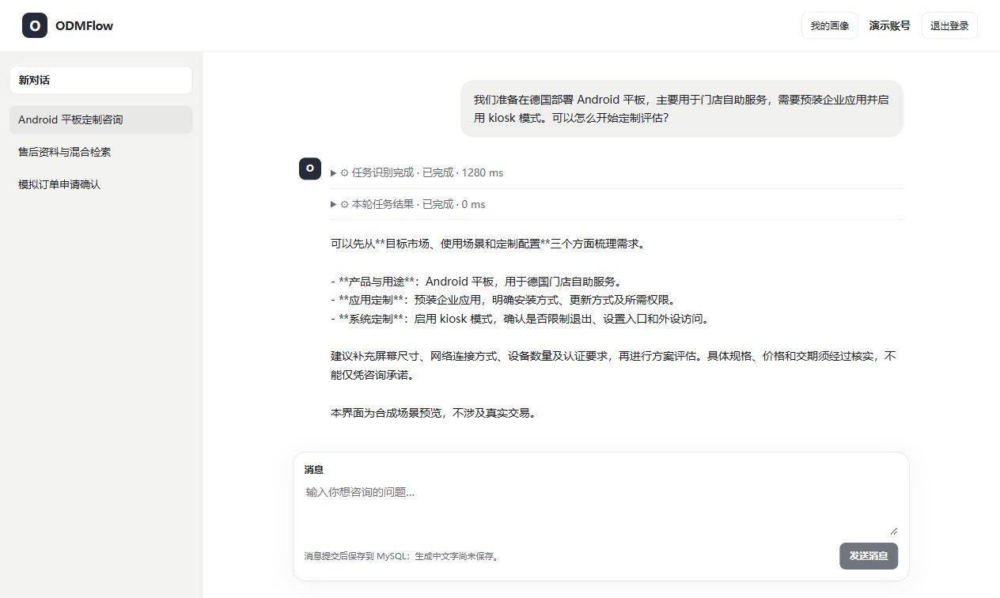
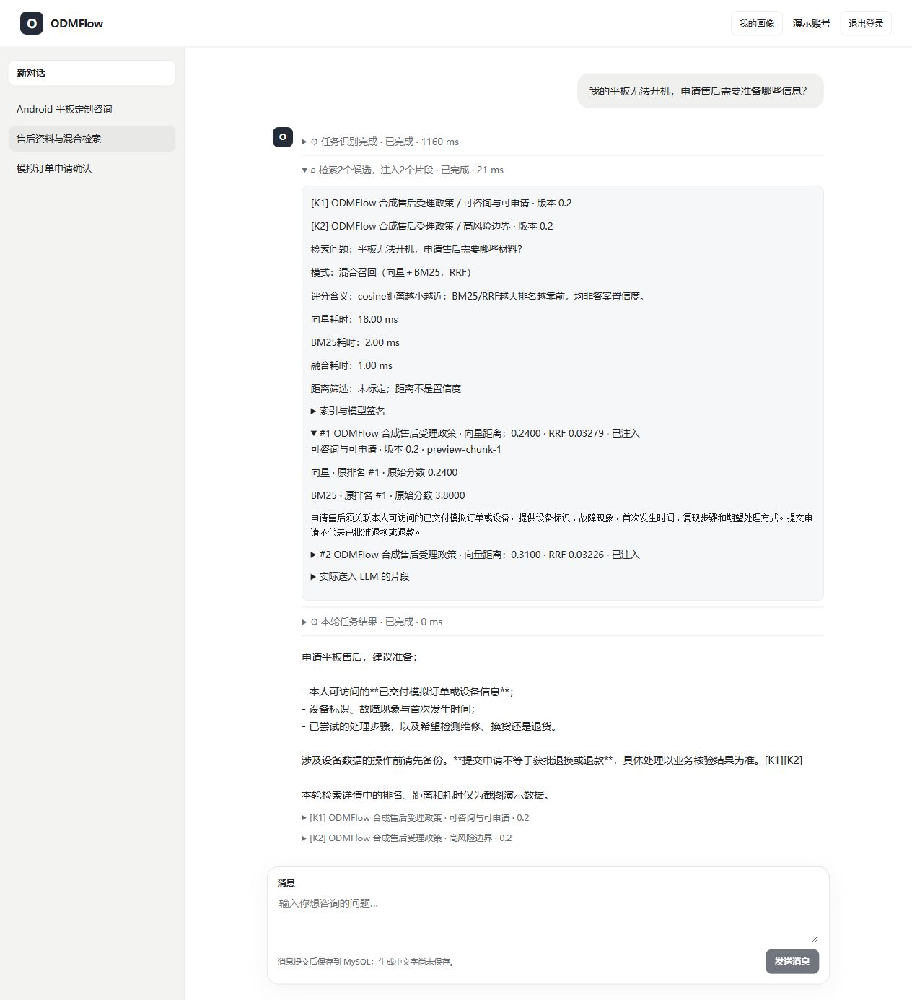
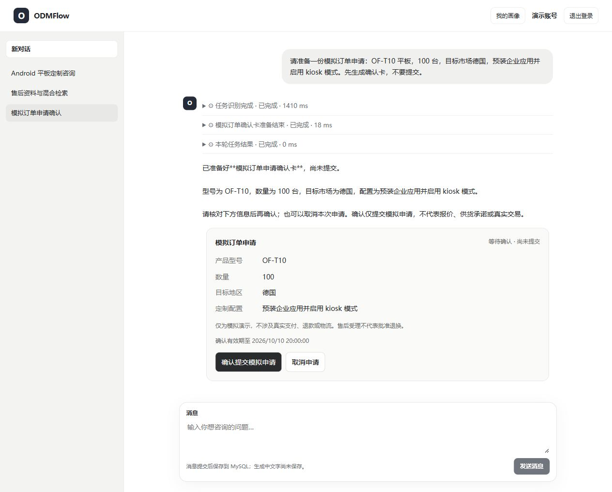

# ODMFlow

面向 Android 手机与平板 ODM 场景的对话式业务 Agent，将知识咨询、需求评估、订单查询与售后申请串联在同一私人对话中。

## 项目背景

ODM 服务涉及目标市场、设备用途、系统与应用定制、订单进度和售后政策等信息。客户往往需要反复描述需求、查找资料并切换业务入口；单纯知识问答又无法完成业务查询与受控申请。

ODMFlow 将企业知识与业务能力结合：用自然语言理解请求，检索相关资料，查询用户可访问的业务记录，并在需要写入时提供明确的确认步骤。目标是减少重复沟通，让咨询依据、办理状态和执行结果对用户可见。

## 项目功能

- **私人持久对话**：注册登录、用户与会话隔离、历史恢复、消息流式输出。
- **ODM 咨询与需求评估**：介绍产品和定制范围，梳理缺失信息并识别明确冲突。
- **知识库问答**：企业资料的向量与关键词混合检索，回答附可追溯来源。
- **任务编排**：拆解复杂请求，按任务依赖执行知识检索与业务能力，保留可观察的执行记录。
- **记忆与偏好**：同会话历史摘要、近期完整消息及用户级结构化画像。
- **订单与售后**：查询本人记录、准备模拟申请确认卡，由用户确认或取消后更新业务状态。
- **执行可视化**：展示工具、任务、检索候选与资料引用，帮助用户理解结果、帮助开发者调试。

## 技术选型

| 范畴       | 技术                                    | 作用                               |
| ---------- | --------------------------------------- | ---------------------------------- |
| 前端       | React、TypeScript、Vite、TanStack Query | 对话交互、身份状态与执行展示       |
| 后端       | Python、FastAPI、Pydantic               | API 服务、输入校验与业务模块       |
| Agent      | LangChain、LangGraph                    | 模型接入、显式任务编排与人工确认   |
| 数据持久化 | MySQL、SQLAlchemy、Alembic              | 业务与会话存储、数据访问和结构迁移 |
| 知识检索   | FastEmbed、Chroma、BM25、RRF            | 本地向量编码与混合召回             |
| 确认状态   | SQLite checkpoint                       | 单进程确认流程的暂停与恢复         |

## 界面预览

下图由本项目实际前端渲染。账号、对话、业务卡和执行记录均使用合成演示数据；检索排名、距离与耗时仅用于展示界面，不代表质量评测或性能测试结果。

### 对话工作区

私人对话列表、消息历史与本轮执行记录。

### 混合检索详情

展开查看检索问题、向量与 BM25 路贡献、RRF 排名和来源片段。

### 模拟申请确认卡

卡片固定在发起申请的原轮次，用户确认之前不执行提交。

## 子项目文档

- [后端：配置、数据库初始化、启动、RAG 与架构](backend/README.md)
- [前端：配置、启动、构建部署与架构](frontend/README.md)

本项目中的订单、售后和企业资料采用合成场景，不涉及真实支付、退款或物流，不代表真实企业的经营承诺。

## 许可证

本项目采用 [MIT License](LICENSE)。依赖库与外部模型分别遵循其自身许可证；仓库不包含模型权重、真实配置或用户数据库。
